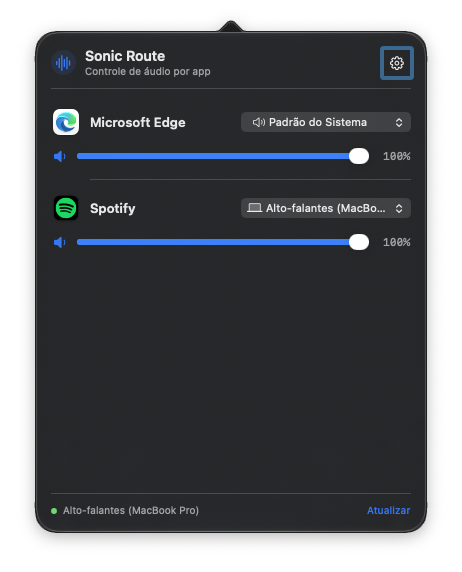
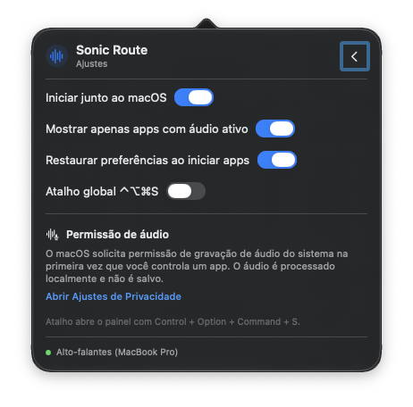

# Sonic Route

A native macOS menu bar utility for controlling each application's output volume, mute state, and audio destination independently. Requires macOS 26 or later.

Português: [README.pt-BR.md](README.pt-BR.md)

Licensed under the [MIT License](LICENSE).

## Prototype status

The app discovers processes that are producing audio and uses their Core Audio process object IDs to create a process tap. A Core Audio I/O proc reads the private aggregate device into a bounded lock-free ring buffer; an `AVAudioSourceNode` feeds the output engine, where a mixer applies gain and routes the stream to the selected device. This uses public APIs rather than simulated per-app controls and does not open the microphone input node. macOS asks for system audio recording permission when capture starts. Audio helpers are grouped under their host app when they are nested in its bundle or use the conventional `.helper` bundle-ID suffix, so browser audio is identified as the browser rather than by the media site.

On the validation Mac, Spotify was discovered and Core Audio created its private tap and aggregate device after system audio recording was authorized. Audible output and latency still need a listening check, and FaceTime routing needs a live call test.

## Demo

Screenshots captured from the running macOS app:

<table>
  <tr>
    <td align="center"><strong>Per-app audio controls</strong><br></td>
    <td align="center"><strong>Settings</strong><br></td>
  </tr>
</table>

## Requirements

- macOS 26 or later
- Xcode 26 to open and run `SonicRoute.xcodeproj`
- Swift 6.0 or later for Swift Package Manager commands

## Run

1. Open `SonicRoute.xcodeproj` in Xcode.
2. Select the **SonicRoute** scheme and run the app.
3. Click the waveform icon in the menu bar.
4. The first time you control an app, allow system audio recording under **System Settings → Privacy & Security**.

The app runs as a menu bar agent and does not appear in the Dock.

## Self-signed DMG distribution

This project can create a self-signed app and DMG for direct distribution. In Keychain Access, choose **Certificate Assistant → Create a Certificate**, name it `Sonic Route Distribution`, and choose **Self Signed Root** and **Code Signing**. Create it once and keep its private key in the maintainer's Keychain; never commit, export, or distribute the private key.

```sh
SIGNING_IDENTITY="Sonic Route Distribution" scripts/package-dmg.sh
```

The script builds the Release app, signs the embedded framework and app bundle with that identity, creates a drag-to-Applications DMG, signs the DMG with the same identity, and verifies both signatures. It writes the package to `dist/`.

This self-signed flow omits the Hardened Runtime. The runtime enables library validation, which requires matching Apple Team IDs for an app and its embedded frameworks; a self-signed certificate has no Apple Team ID, so the runtime prevents this app from loading its framework. This is suitable only for the accepted, non-notarized distribution path. See Apple's [library validation documentation](https://developer.apple.com/documentation/BundleResources/Entitlements/com.apple.security.cs.disable-library-validation).

Keep using the same certificate and bundle identifier for updates so macOS can recognize the app's code identity when tracking its audio-capture permission. Each user still grants system audio recording access on their Mac. A self-signed identity does not establish an Apple-verified publisher, and this package is not notarized; Gatekeeper may require users to approve opening it manually. Apple notarization requires a Developer ID Application certificate, so this flow does not support notarization. See [Apple's code signing guide](https://developer.apple.com/library/archive/documentation/Security/Conceptual/CodeSigningGuide/Procedures/Procedures.html) and [notarization requirements](https://developer.apple.com/documentation/security/notarizing-macos-software-before-distribution).

## Tests

The unit tests use Swift Testing to cover volume rules, output fallback, app filtering, persistence by bundle identifier, and restoring controls when an app starts producing audio.

```sh
swift test
```

In Xcode, select the **SonicRoute** scheme and choose **Product → Test**.

## Architecture

- **MenuBarPanelView** and **ApplicationRowView** provide the compact SwiftUI panel, per-app controls, and loading, empty, and error states.
- **MenuBarViewModel** coordinates application rows, preferences, outputs, and periodic refreshes.
- **AudioDeviceServicing** enumerates output devices and identifies the system default.
- **AudioSessionServicing** discovers active audio processes and controls sessions by bundle identifier.
- **CoreAudioSessionService** resolves nested helper processes and conventional `.helper` bundle IDs to their host app when possible; other helpers can still appear under their own process identity. It creates a private process tap for an app's active Core Audio process object IDs, reads it through an aggregate-device I/O proc, and routes it through an `AVAudioSourceNode` and `AVAudioEngine` to the selected device. It refreshes the tap target if those process objects change.
- **AppAudioPreferenceStore** persists volume, mute, and output choice by bundle identifier.
- Service protocols make rules and control state testable without physical audio hardware.

Audio stays in memory and is not recorded or sent over the network. Gain is applied by the local mixer. If a selected output disconnects, the app uses the macOS default and returns to the preferred output when it becomes available again.

## Permissions and known limitations

- The app declares `NSAudioCaptureUsageDescription`. Reading a process tap requires macOS consent for system audio recording. If consent is denied or a session cannot start, the app reports the error and leaves the original app without active routing.
- macOS provides no public setter for another app's volume or output device. The prototype mutes the original process while reading its tap and plays the captured stream; this can add latency.
- Compatibility varies by app, audio format, protected content, and device. Spotify and FaceTime need live testing before broad compatibility can be claimed.
- The app controls output audio. The macOS system continues to control the call microphone.
- System Sounds is omitted as an independent application because macOS does not document a stable process session with its own volume and mute controls.
- The first version does not install a virtual driver. Core Audio taps capture per-process output; a separate HAL driver would add privileged installation and is not required for this capture path.

## Project layout

```text
Sources/
  SonicRoute/       # app entry point and SwiftUI/AppKit views
  SonicRouteCore/   # models, rules, services, and view model
Tests/
  SonicRouteCoreTests/
```
